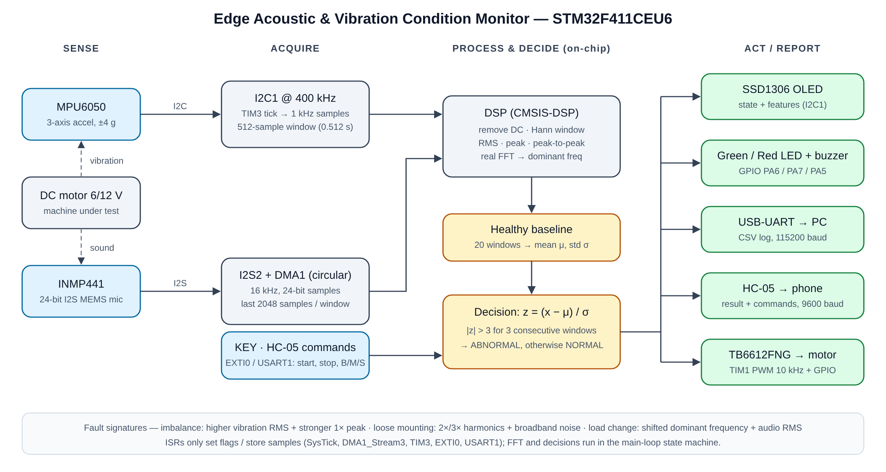
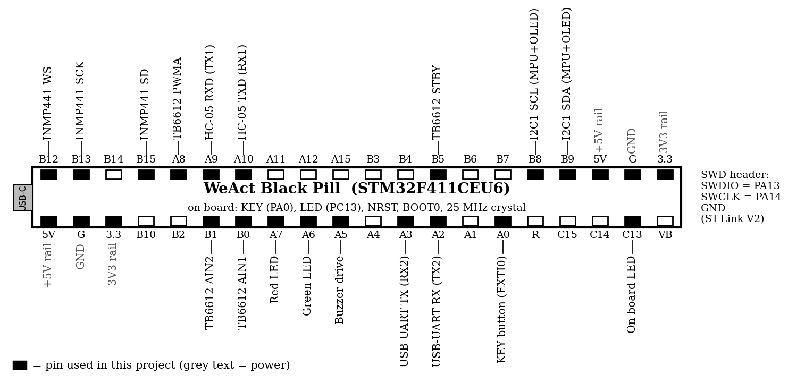
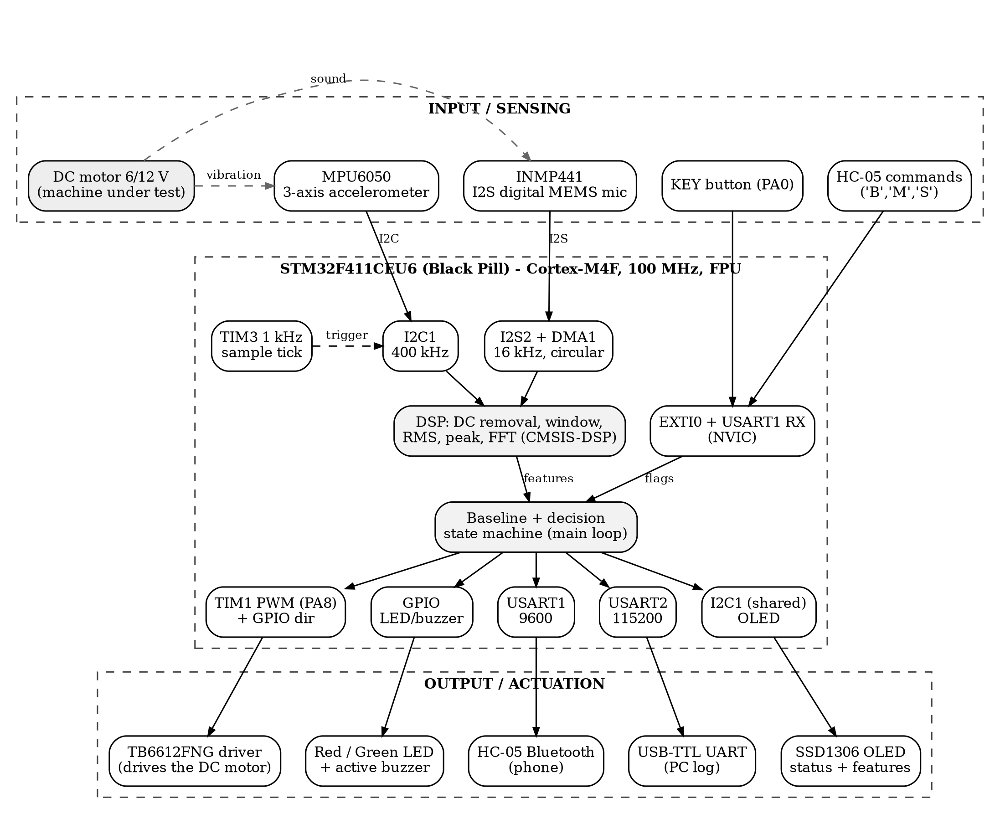
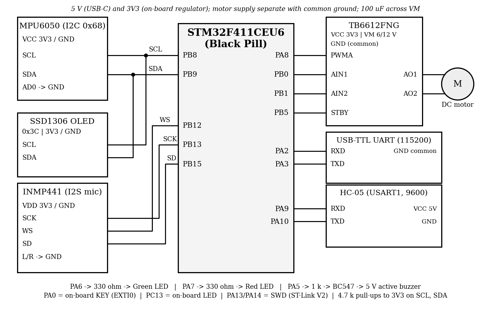
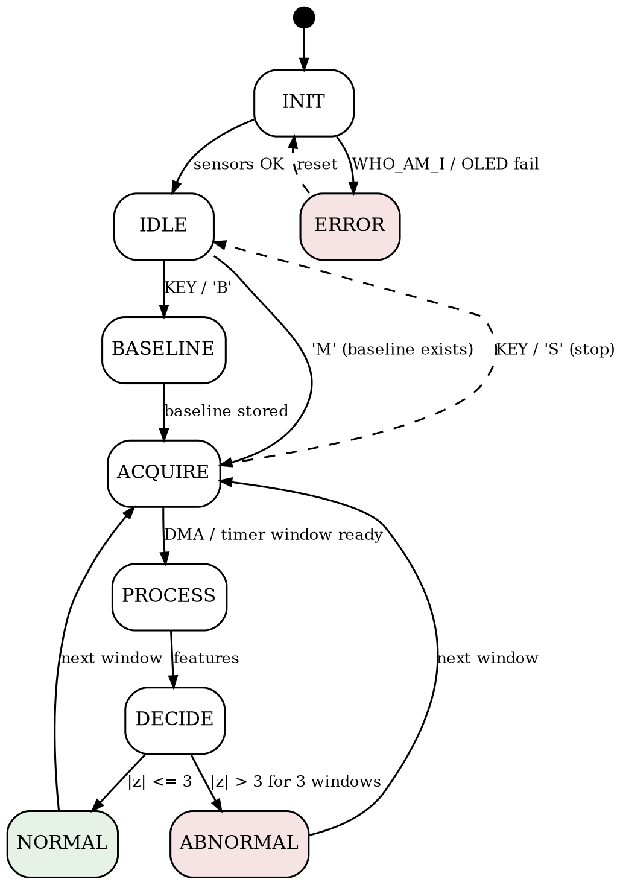
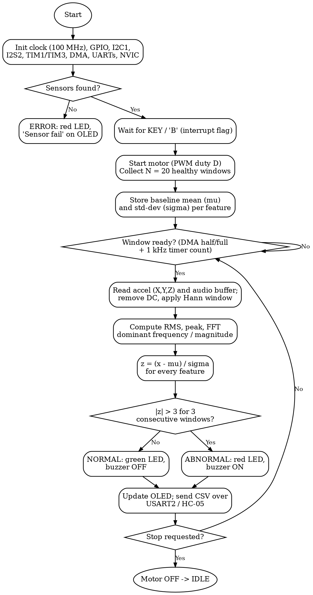

# Edge Acoustic and Vibration Condition Monitoring System using STM32F411CEU6

> **23CSE304 – Embedded Systems · Case Study Report**

## Academic Details and Acknowledgement

| | |
|---|---|
| **Student Name(s) and Registration Number(s)** | 1. [Nitharshan CK] – [CB.SC.U4CSE24532] <br> 2. [Parthiv Surya] – [CB.SC.U4CSE24535] <br> 3. [Prasanna B] – [CB.SC.U4CSE24537] <br> 4. [Awaaz ] – [CB.SC.U4CSE24562] |
| **Mentor** | Dr. A. Baskar |
| **Course** | 23CSE304 – Embedded Systems |
| **Department** | Department of Computer Science and Engineering |
| **Institution** | School of Computing, Amrita Vishwa Vidyapeetham, Coimbatore, India. |

This case study was carried out under the academic guidance of Dr. A. Baskar and the institutional affiliation stated above.

**Quick links:** [One-page write-up](docs/one-page-writeup.md) ([PDF](docs/one-page-writeup.pdf)) · [System overview diagram](docs/images/system_overview.svg)




[## Video-Link](https://drive.google.com/drive/folders/1awMBn8Rxh1Ucm2EdHyosRDH7NANug61b?usp=sharing)

---

## Contents
1. [Problem Statement](#1-problem-statement)
2. [Objectives](#2-objectives)
3. [Hardware Components Used](#3-hardware-components-used)
4. [Pin Specifications, Connections, Inputs and Outputs](#4-pin-specifications-connections-inputs-and-outputs)
5. [Architecture Diagram](#5-architecture-diagram-block-diagram)
6. [System Design](#6-system-design)
7. [Tools / Software Used](#7-tools--software-used)
8. [Conclusion](#8-conclusion)

## 1. Problem Statement

Faults in small rotating machines show up as changes in vibration and sound long before a breakdown. Checking this by ear or with a handheld meter is subjective and needs an expert, while industrial monitors are costly. This project builds a low-cost, STM32F411CEU6-based edge monitor for a small 6 V/12 V DC motor. An MPU6050 senses vibration and an INMP441 digital microphone senses sound. The microcontroller records a healthy baseline, extracts RMS, peak and FFT features locally, and raises an alert (OLED, LEDs, buzzer, UART/Bluetooth) when the motor deviates from that baseline, for example due to rotor imbalance, loose mounting or load change.

## 2. Objectives

1. Measure the vibration of a small DC motor with the MPU6050 accelerometer (I2C).
2. Capture the motor sound with the INMP441 digital MEMS microphone (I2S + DMA); no ADC is needed because it replaces the analog MAX9814.
3. Acquire both signals reliably using timers, DMA and NVIC interrupts.
4. Compute features: RMS, peak, peak-to-peak and dominant frequency (FFT).
5. Build a healthy baseline (mean and standard deviation) from normal operation.
6. Detect abnormal behaviour caused by controlled imbalance, loose mounting or load change.
7. Show the condition on a 0.96" SSD1306 OLED and indicate it with red/green LEDs and a buzzer.
8. Send measurements to a PC over USB-UART (and optionally to a phone over HC-05); start/stop by KEY button (EXTI) or Bluetooth command (UART).
9. Control the motor safely through the TB6612FNG driver, and keep the design ready for a later TinyML classifier.

## 3. Hardware Components Used

| No. | Component (qty) | Key specification | Usage in this project |
|---|---|---|---|
| 1 | STM32F411CEU6 Black Pill (1) | ARM Cortex-M4F with FPU, up to 100 MHz, 512 KB Flash, 128 KB RAM, 3.3 V logic, 25 MHz crystal, USB-C 5 V in; on-board KEY (PA0), LED (PC13) | Main controller: acquisition, DSP, decision logic, motor control, display and telemetry |
| 2 | ST-Link V2 (1) | SWD programmer/debugger | Flashing and debugging from Keil |
| 3 | DC motor 6 V / 12 V (1) | Small brushed DC motor | Machine under observation |
| 4 | MPU6050 (1) | 3-axis accelerometer + gyro, 16-bit, ±2/4/8/16 g, I2C up to 400 kHz, address 0x68, 3.3 V | Vibration (X, Y, Z acceleration) |
| 5 | INMP441 (1) | MEMS microphone, 24-bit I2S output, 3.3 V, 1.8–3.3 V supply | Acoustic signal (replaces MAX9814) |
| 6 | 0.96" SSD1306 OLED (1) | 128×64 pixels, I2C address 0x3C | Condition and feature display |
| 7 | TB6612FNG driver (1) | Dual H-bridge, VM 4.5–13.5 V, 1.2 A per channel, logic 2.7–5.5 V (L298N also works) | Drives the motor from PWM/GPIO signals |
| 8 | 5 V active buzzer (1) | Built-in oscillator; driven by BC547 + 1 kΩ transistor stage | Audible abnormal-condition alert |
| 9 | Red + Green LEDs (1 each) | With 330 Ω series resistors | Visual status (normal / abnormal) |
| 10 | USB-to-UART adapter (1) | 3.3 V logic, 115200 baud | Telemetry/debug log to PC |
| 11 | HC-05 Bluetooth (1, optional) | Bluetooth 2.0 SPP, ~10 m, 3.6–6 V supply, 3.3 V logic, 9600 baud | Wireless telemetry; receives commands |
| 12 | Power supply | 5 V regulated for electronics + suitable 6/12 V motor supply, common GND | Powers electronics and motor separately |
| 13 | Breadboard, jumper wires | Full-size breadboard; male-male and male-female wires | Prototype wiring |

## 4. Pin Specifications, Connections, Inputs and Outputs

### (a) Interface network – each sensor/actuator path uses dedicated MCU pins

| Interface | STM32 pins | Peripheral / alternate function | Role |
|---|---|---|---|
| I2C bus (shared) | PB8 (SCL), PB9 (SDA) | I2C1, AF4, 400 kHz | MPU6050 (0x68) and OLED (0x3C) on one bus |
| I2S audio | PB12 (WS), PB13 (CK), PB15 (SD) | I2S2 receive, AF5, DMA1 | INMP441 samples at 16 kHz (24-bit in 32-bit slot) |
| Motor driver | PA8 (PWMA), PB0 (AIN1), PB1 (AIN2), PB5 (STBY) | TIM1_CH1 PWM (AF1) + GPIO | Speed by duty cycle; direction and enable by GPIO |
| USB-UART | PA2 (TX), PA3 (RX) | USART2, AF7, 115200 baud | CSV telemetry and debug to PC |
| Bluetooth | PA9 (TX), PA10 (RX) | USART1, AF7, 9600 baud | Result to phone; commands B / M / S |
| Alerts | PA6 (Green), PA7 (Red), PA5 (Buzzer) | GPIO output | Status LEDs and buzzer drive |
| User / debug | PA0 (KEY), PC13 (LED), PA13/PA14 | EXTI0, GPIO, SWD | Start/stop button, heartbeat LED, ST-Link |

The motor is switched by the TB6612FNG from a separate supply, so no motor current flows through a GPIO pin. The pin map is a proposed plan; confirm alternate functions against your board schematic before final wiring.

### (b) Module pin details

| Module | Pin | Specification | STM32 pin |
|---|---|---|---|
| MPU6050 | VCC / GND | 3.3 V supply | 3V3 / GND |
| | SCL / SDA | I2C1, open-drain, 400 kHz, 4.7 kΩ pull-ups | PB8 / PB9 |
| | AD0 / INT | AD0 to GND selects address 0x68; INT not used | GND / not used |
| INMP441 | VDD / GND | 3.3 V supply | 3V3 / GND |
| | SCK | Bit clock = 16 kHz × 64 = 1.024 MHz | PB13 (I2S2_CK) |
| | WS | Word select = sample rate, 16 kHz | PB12 (I2S2_WS) |
| | SD | Serial data out, 24-bit MSB first | PB15 (I2S2_SD) |
| | L/R | Tied to GND = left channel | GND |
| SSD1306 OLED | VCC / GND, SCL / SDA | 3.3 V, I2C address 0x3C, shares the I2C1 bus | 3V3 / GND, PB8 / PB9 |
| TB6612FNG | VM / VCC / GND | VM = 6/12 V motor supply, VCC = 3.3 V logic, common GND | Ext. supply / 3V3 / GND |
| | PWMA, AIN1, AIN2, STBY | PWM 10 kHz; direction inputs; STBY high = enabled | PA8, PB0, PB1, PB5 |
| | AO1 / AO2 | Motor outputs (BIN/PWMB unused, tied low) | DC motor |
| Buzzer / LEDs | Signal pins | Buzzer via 1 kΩ + BC547; LEDs via 330 Ω, active-high | PA5; PA6 (G), PA7 (R) |
| HC-05 | VCC / GND | 5 V supply (3.6–6 V) | 5V / GND |
| | RXD / TXD | UART, 3.3 V logic, 9600 baud | PA9 (TX) / PA10 (RX) |
| | STATE, EN | Link status; AT-mode select | Not used |
| USB-UART | RXD / TXD / GND | UART, 3.3 V logic, 115200 baud | PA2 (TX) / PA3 (RX) / GND |
| ST-Link V2 | SWDIO / SWCLK / GND | Serial Wire Debug | PA13 / PA14 / GND |
| KEY / LED (board) | button / LED | KEY: to GND, internal pull-up, EXTI0; LED: active-low | PA0 / PC13 |

### (c) Inputs and outputs of the device

| Signal | I/O | Type / interface | Range or format |
|---|---|---|---|
| Vibration X, Y, Z | In | I2C1, MPU6050, sampled by TIM3 at 1 kHz | ±4 g range, 16-bit (8192 LSB/g) |
| Motor audio | In | I2S2 + DMA circular buffer, INMP441 | 16 kHz, 24-bit signed samples |
| KEY button | In | Digital, PA0, EXTI0 | Active-low, falling edge |
| Bluetooth command | In | USART1, 9600 baud | 'B' = baseline, 'M' = monitor, 'S' = stop |
| Motor drive | Out | TIM1 PWM + GPIO to TB6612FNG | 10 kHz PWM, duty 0–100 % |
| OLED text | Out | I2C1, 128×64 pixels | State, vibration RMS, frequency, audio RMS |
| LEDs and buzzer | Out | GPIO PA6, PA7, PA5 | Green = normal; red + buzzer = abnormal |
| Telemetry | Out | USART2 115200 / USART1 9600 | CSV: `Time,Vib_RMS,Audio_RMS,Freq,Status` |

### (d) Pin diagram – STM32F411CEU6 Black Pill (black = pin used)



*Figure 1. Black Pill pin diagram with project connections*

## 5. Architecture Diagram (Block Diagram)



*Figure 2. Block diagram of the monitoring system*

- **Input blocks:** DC motor (vibration and sound source), MPU6050, INMP441, KEY button, HC-05 commands, USB-C power, ST-Link.
- **Processing block:** STM32F411 acquires data (I2C, I2S + DMA, timers), runs DSP (DC removal, windowing, RMS, FFT), builds the baseline and decides the condition.
- **Output blocks:** TB6612FNG motor driver, OLED, LEDs and buzzer, USB-UART (PC log), HC-05 (phone).

## 6. System Design

### 6.1 Circuit Schematic Diagram (Connection Diagram)



*Figure 3. Connection diagram: sensors (left), STM32 Black Pill (centre), driver and communication modules (right)*

### Identification method (how the condition is decided)

1. **Acquire:** MPU6050 sampled at 1 kHz (TIM3) into a 512-sample window (0.512 s); INMP441 streamed at 16 kHz by I2S2 + DMA, last 2048 samples used per window.
2. **Pre-process:** subtract the mean (removes gravity/DC offset) and apply a Hann window before the FFT.
3. **Features:** vibration RMS, peak, dominant frequency; audio RMS, peak, dominant frequency (CMSIS-DSP real FFT).
4. **Baseline:** with the motor healthy, 20 windows give mean μ and standard deviation σ for each feature.
5. **Decide:** z-score of every feature; if |z| > 3 for 3 consecutive windows the state is ABNORMAL, otherwise NORMAL. Hints: imbalance raises vibration RMS and the 1× running-frequency peak; loose mounting adds 2×/3× harmonics and broadband noise; load change shifts the dominant frequency and audio RMS.

### Formulas

```text
a = raw / 8192            (g, ±4 g range)
x = raw24 / 2^23          (audio, -1 to +1)
x'[n] = x[n] - mean(x)

RMS = sqrt( (1/N) * sum(x'[n]^2) )
Peak = max|x'[n]|
Peak-to-peak = max(x') - min(x')

X[k] = sum_n x'[n] * w[n] * exp(-j*2*pi*k*n/N)
f_k = k * f_s / N
f_dom = f_k at max|X[k]|, 1 <= k <= N/2

Resolution df = f_s / N:  vibration 1000/512 = 1.95 Hz;  audio 16000/2048 = 7.8 Hz
f_run = rpm / 60

z = (x - mu_b) / sigma_b
mu_b = (1/N_b) * sum(x_b)
sigma_b = sqrt( sum((x_b - mu_b)^2) / (N_b - 1) ),  N_b = 20

f_PWM = f_TIM / ((PSC+1)(ARR+1)) = 100 MHz / (100 x 100) = 10 kHz
Duty  = CCR / (ARR+1)
```

### Interrupts (NVIC)

| Source | IRQ | Priority | Action |
|---|---|---|---|
| SysTick | SysTick_IRQn | 0 | 1 ms tick for timeouts, debounce and buzzer pattern |
| I2S2 RX DMA | DMA1_Stream3_IRQn | 1 | Half/full buffer complete: mark audio window ready |
| TIM3 update (1 kHz) | TIM3_IRQn | 2 | Read MPU6050 X, Y, Z sample into the vibration buffer |
| KEY button (PA0) | EXTI0_IRQn | 3 | Debounce, set start/stop flag |
| USART1 receive | USART1_IRQn | 4 | Read 'B', 'M' or 'S' from phone, set flag |

**Firmware:** C with CMSIS and CMSIS-DSP, 100 MHz clock (25 MHz HSE → PLL). ISRs stay short and only set flags or store samples; FFT and decisions run in the main-loop state machine.

### 6.2 Schematic State Diagram



*Figure 4. State diagram*

| State | Action | OLED shows |
|---|---|---|
| INIT | Set up clock, GPIO, I2C, I2S, TIM, DMA, UART, NVIC | Monitor v1.0 |
| IDLE | Motor off; wait for KEY / BT | Ready / Press KEY |
| BASELINE | Motor on; learn μ, σ from 20 windows | Learning n/20 |
| ACQUIRE | Fill vibration and audio windows | Monitoring… |
| PROCESS | DC removal, window, RMS, FFT | --- |
| DECIDE | z-scores, 3-window rule | --- |
| NORMAL | Green LED on, buzzer off | NORMAL + values |
| ABNORMAL | Red LED + buzzer on | ABNORMAL + values |
| ERROR | Sensor missing (WHO_AM_I ≠ 0x68) | Sensor fail |

### 6.3 Flow Diagram



*Figure 5. Flow diagram of the monitoring loop*

## 7. Tools / Software Used

| Tool | Purpose |
|---|---|
| Keil µVision 5 (MDK-ARM) + CMSIS, CMSIS-DSP | C firmware: build and debug; register definitions, NVIC, SysTick, FFT functions |
| STM32CubeMX (optional) | Clock tree, pin alternate-function and I2S/DMA configuration check |
| ST-Link V2 + STM32CubeProgrammer | Flashing and debugging over SWD |
| Tera Term / serial terminal | Telemetry log from USART2 (115200 baud) |
| Serial Bluetooth Terminal (Android) | Phone interface over HC-05 |
| Python (NumPy, Matplotlib), Graphviz | Offline FFT check, plots, and the block/state/flow/pin diagrams |
| Digital multimeter | Power rails and wiring verification |

## 8. Conclusion

The system turns a small DC motor into a monitored machine: the MPU6050 and INMP441 supply vibration and sound, the STM32F411 extracts RMS and FFT features at the edge, compares them with a learned healthy baseline, and signals the result on the OLED, LEDs, buzzer and UART/Bluetooth. Using the digital INMP441 instead of the analog MAX9814 removes the ADC from the audio path.

**Limitations:** thresholds depend on the baseline recorded for one motor and mounting, so they must be tuned from experiments; fault tests must stay mechanically safe; all logic is 3.3 V. A TinyML classifier is a planned extension.

---

*Course: 23CSE304 – Embedded Systems · Mentor: Dr. A. Baskar · Department of Computer Science and Engineering, School of Computing, Amrita Vishwa Vidyapeetham, Coimbatore, India.*
